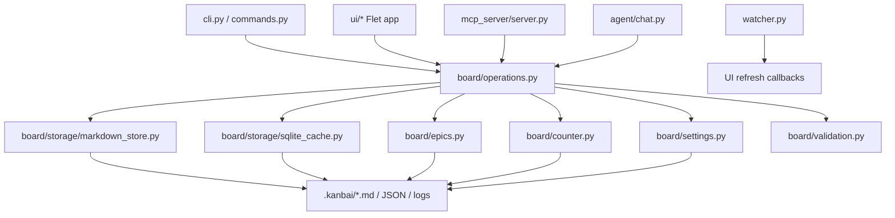

# Kanbai from Scratch

> A learning-first, refactor-friendly guide to understanding Kanbai end-to-end.

This folder is for **developer tutorials** that explain how Kanbai works today,
so future changes are faster, safer, and less token-intensive.

The goal is not just to document features, but to build a mental model of the
whole system:

- how the app boots
- where board state lives
- how the UI reads and writes data
- how MCP and the chat agent reuse the same operations layer
- how refresh, sync, and caching stay consistent
- where refactors are safe vs risky

---

## Current architecture at a glance

### Core idea

Kanbai has **one source of truth for writes**: the board operations layer.
Everything else is a front-end or adapter:

- **CLI** for command-line work
- **Flet UI** for humans
- **MCP** for external agents
- **Chat agent** for in-app AI

That means the best way to understand Kanbai is to understand the operations
pipeline and the data it touches.

---

## Suggested reading order

1. **Project anatomy and boot sequence**
2. **Board state: files, folders, and card format**
3. **The operations layer: create / update / move / archive**
4. **Epics, card numbers, links, comments, and attachments**
5. **Storage internals: Markdown source of truth + SQLite cache**
6. **UI internals: board, dialogs, search, health, graph, table**
7. **Live refresh: watcher, sync, and UI invalidation**
8. **MCP surface and access tiers**
9. **Embedded AI chat: tool calls and guardrails**
10. **Refactor playbooks: what to change safely, and how**

---

## Tutorial outline

### 1. Project anatomy and boot sequence

**Goal:** understand how `kanbai`, `kanbai serve`, and `kanbai init` work.

Covers:

- `src/kanbai/cli.py`
- `src/kanbai/commands.py`
- `src/kanbai/paths.py`
- startup flow from CLI to UI/MCP
- how project root discovery works
- how `.env` and `.kanbai/` are located

### 2. Board state: files, folders, and card format

**Goal:** understand the on-disk board model.

Covers:

- `.kanbai/backlog`, `in_progress`, `review`, `done`
- `attachments/`, `counter.json`, `epics.json`, `settings.json`
- `transitions.jsonl`, `activity.jsonl`
- card frontmatter and body structure
- what is committed vs derived

### 3. The operations layer

**Goal:** learn the single place where writes should go.

Covers:

- `board/operations.py`
- `create_card`, `update_card`, `move_card`
- `archive_card`, `unarchive_card`
- comment and link mutations
- why every caller should reuse the same functions

### 4. Epics, numbering, links, comments, and attachments

**Goal:** understand the board's higher-level concepts.

Covers:

- `board/epics.py`
- `board/counter.py`
- `assigned_to`, `epic`, and `archived` semantics
- typed links and graph relationships
- comments, attachments, and lifecycle rules

### 5. Storage internals: Markdown source of truth + SQLite cache

**Goal:** understand persistence and query performance.

Covers:

- `board/storage/markdown_store.py`
- `board/storage/sqlite_cache.py`
- `board/storage/sync.py`
- why `.md` files remain the source of truth
- why `.cache.db` is derived
- how `full_sync()` rebuilds cache state

### 6. UI internals: board, dialogs, search, health, graph, table

**Goal:** understand how the Flet app is structured.

Covers:

- `ui/kanban_page.py`
- `ui/board_view.py`
- `ui/card_dialog.py`
- `ui/search_overlay.py`
- `ui/health_page.py`
- `ui/graph_page.py`
- `ui/table_page.py`
- `ui/chat_panel.py`
- refresh patterns and partial redraws

### 7. Live refresh: watcher, sync, and UI invalidation

**Goal:** understand how external changes make it back to the screen.

Covers:

- `watcher.py`
- file-system events and debounce
- how `.kanbai` changes trigger refresh
- sync boundaries and stale-state prevention

### 8. MCP surface and access tiers

**Goal:** understand how external agents safely control the board.

Covers:

- `mcp_server/server.py`
- read / write / yolo access tiers
- tool registration and capability gating
- how MCP maps back to board operations

### 9. Embedded AI chat: tool calls and guardrails

**Goal:** understand the in-app assistant and how it stays bounded.

Covers:

- `agent/chat.py`
- chat modes and tool permissions
- model resolution and context window tracking
- why the chat agent is not arbitrary code execution

### 10. Refactor playbooks: what to change safely, and how

**Goal:** make future work cheaper and less error-prone.

Covers:

- how to add a new board field end-to-end
- how to add a new mutation safely
- how to add a new UI view without breaking refreshes
- how to extend MCP without leaking unsafe writes
- common failure modes and how to avoid them

---

## Writing style for these tutorials

Keep each tutorial:

- **short but complete**
- **diagram-first** when helpful
- **code-path oriented** rather than feature-marketing oriented
- **refactor aware** — explain where the seams are
- **token efficient** — prefer precise references over repeating the whole repo

A good tutorial answers:

1. What problem does this subsystem solve?
2. What files own it?
3. What data does it read/write?
4. What invariants matter?
5. What breaks if we change it carelessly?

---

## Next step

When we start writing the actual tutorials, each one should link back here and
use the same architecture vocabulary so the whole set stays consistent.
