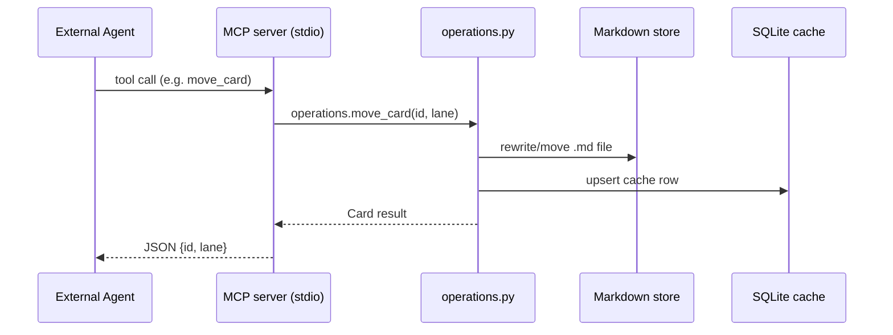
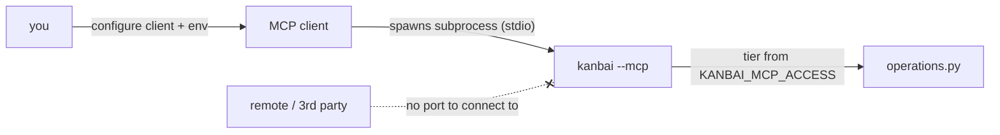

# Kanbai — MCP & External Agents

> How Kanbai exposes itself to external AI agents over the **Model Context
> Protocol (MCP)**, what those agents can do, how to wire them up, the
> **access-tier model** (`KANBAI_MCP_ACCESS=read|write|yolo`), and how
> authentication works on a stdio transport.

The server lives in `mcp_server/server.py` and is built on **fastmcp** over the
**stdio** transport.

---

## Table of contents

1. [What MCP gives you](#what-mcp-gives-you)
2. [Access tiers (`KANBAI_MCP_ACCESS`)](#access-tiers-kanbai_mcp_access)
3. [Current capabilities (tool catalog)](#current-capabilities-tool-catalog)
4. [How a call flows](#how-a-call-flows)
5. [Hooking up external agents](#hooking-up-external-agents)
6. [How are external agents authenticated?](#how-are-external-agents-authenticated)
7. [Security posture today](#security-posture-today)
8. [Roadmap](#roadmap)

---

## What MCP gives you

MCP lets an external agent (GitHub Copilot, Claude Desktop, Cursor, a custom
client, etc.) call Kanbai's board operations as **tools**. Because the server
routes everything through the same `board/operations.py` layer the UI and in-app
agent use, an external agent gets **identical write semantics** — Markdown and
the SQLite cache stay in sync no matter who made the change.

Run it:

```powershell
uv run python main.py --mcp
```

This starts `mcp.run(transport="stdio")` — the client launches the process and
talks to it over stdin/stdout.

---

## Access tiers (`KANBAI_MCP_ACCESS`)

MCP access is gated by a single environment variable that mirrors the in-app
chat agent's permission model. Tools above the configured tier are **never
registered**, so a jailbroken or confused client cannot reach them — they simply
aren't offered.

| `KANBAI_MCP_ACCESS` | Tools exposed | Use case |
|---------------------|---------------|----------|
| `read` | read-only: list/get/summary/list_epics | Reporting, dashboards, untrusted / 3rd-party agents. |
| `write` *(default)* | read **+** create/update/move/archive/unarchive/link/epics | Trusted automation; **no permanent delete**. |
| `yolo` | write **+** `delete_card` | Explicit opt-in for an agent you fully trust; allows irreversible deletion. |

This maps directly onto the chat agent's Ask/Plan (read) → Agent (write) → Yolo
(delete) tiers. The default is **`write`**: external agents can create and modify
freely but must *archive* rather than destroy — permanent deletion requires a
deliberate `yolo` opt-in.

**Implementation** (`mcp_server/server.py`): a small `tool(tier)` decorator wraps
`@mcp.tool()` and only registers the function when the tier rank is `<=` the
configured access level. An invalid/unset value falls back to `write`.

```powershell
# read-only server
$env:KANBAI_MCP_ACCESS = "read"; uv run python main.py --mcp

# default (write) — create/modify, but no permanent delete
uv run python main.py --mcp

# full power incl. permanent delete
$env:KANBAI_MCP_ACCESS = "yolo"; uv run python main.py --mcp
```

> Set this in the **client's** server config env (see below) so each agent gets
> exactly the tier you intend.

---

## Current capabilities (tool catalog)

The server exposes **15 tools**, grouped by the tier that unlocks them.

### Read tier (always available)

| Tool | Description |
|------|-------------|
| `list_cards` | List/filter cards by lane, tags, archived, text query, or epic. |
| `get_card` | Full details of one card by ID. |
| `get_card_by_number` | Look up a card by its task number. |
| `list_epics` | Epic names (optionally including archived). |
| `get_board_summary` | Aggregated analytics: counts by lane/priority, completion %, avg age, top tags, 90-day CFD, this-year heatmap. Optional epic filter. |
| `project_health` | Overall project health (good/watch/bad) plus the 8 A-series signals. |
| `health_model` | Full health model documentation as Markdown. |
| `list_docs` / `get_doc` | Discover and read Kanbai documentation files. |

### Write tier (`write` and `yolo`)

| Tool | Description |
|------|-------------|
| `create_card` | Create a card (with optional epic). |
| `update_card` | Update fields; `set_epic` flag distinguishes "leave" from "clear". |
| `move_card` | Move a card to another lane. |
| `archive_card` / `unarchive_card` | Soft-delete / restore. |
| `set_card_epic` | Assign an epic to a card by task number. |
| `archive_epic` / `unarchive_epic` | Archive/restore an epic + its snapshotted cards. |
| `link_cards` / `unlink_cards` | Typed relationships (auto-inverse). |

### Yolo tier (`yolo` only)

| Tool | Description |
|------|-------------|
| `delete_card` | **Permanent** delete. Requires the card to be archived first; irreversible. |

---

## How a call flows



The MCP layer is a thin wrapper: each tool validates/loads inputs and delegates
to `operations.py` (or `epics.py`).

---

## Hooking up external agents

MCP clients launch the server as a subprocess. The shape is the same everywhere;
syntax varies by client.

> **Kanbai anchors its data to its own repo location, not the launch directory.**
> All data paths (`board_data/`, `.cache.db`, `.env`) resolve relative to
> `paths.py` in the Kanbai repo — see [`paths.py`](../paths.py). So you can
> launch the server from **any** working directory as long as you point at
> Kanbai's `main.py` by **absolute path**. The common case is "I'm coding in
> *project-X* and want its agent to manage my Kanbai board," and that just works.

**Generic stdio server entry:**

- **command:** `uv`
- **args:** `["run", "--project", "<abs path to kanbai>", "python", "<abs path to kanbai>/main.py", "--mcp"]`
- **cwd:** not required — paths anchor to the Kanbai repo regardless.

Using `--project <abs path to kanbai>` makes `uv` resolve Kanbai's environment,
and giving `main.py` by absolute path puts the Kanbai repo on `sys.path` so its
data files resolve no matter where the agent was launched.

**Example — Claude Desktop / Cursor (`mcp.json`-style):**

```json
{
  "mcpServers": {
    "kanbai": {
      "command": "uv",
      "args": [
        "run",
        "--project", "C:/Users/you/code/omega",
        "python", "C:/Users/you/code/omega/main.py", "--mcp"
      ],
      "env": { "KANBAI_MCP_ACCESS": "write" }
    }
  }
}
```

**Example — VS Code, working in a *different* repo (`.vscode/mcp.json` or user
`settings.json`):**

```json
{
  "servers": {
    "kanbai": {
      "type": "stdio",
      "command": "uv",
      "args": [
        "run",
        "--project", "C:/Users/you/code/omega",
        "python", "C:/Users/you/code/omega/main.py", "--mcp"
      ],
      "env": { "KANBAI_MCP_ACCESS": "write" }
    }
  }
}
```

The agent in *project-X* now sees Kanbai's tools. A natural workflow: name an
**epic** after the project (e.g. `project-x`), then have that repo's agent
`create_card`/`set_card_epic`/`move_card` under that epic as you work — your
board tracks work for a codebase it doesn't live in.

> **Tip — make it global so every repo's agent can reach it.** Put the server in
> your **user-level** MCP config instead of a per-repo `.vscode/mcp.json`:
> - VS Code: run **MCP: Open User Configuration** (or add it to user
>   `settings.json`), so the `kanbai` server is available in every workspace.
> - Claude Desktop / Cursor: the config above is already global to that client.
>
> Because the args use absolute paths, the server behaves identically no matter
> which project you launched the agent from.

**Notes**
- Paths anchor to the Kanbai repo via `paths.py`, so `cwd` doesn't matter —
  just reference `main.py` by absolute path (and `--project` for the env).
- Set `KANBAI_MCP_ACCESS` per client to choose its tier (defaults to `write`).
- The SQLite cache is rebuilt from Markdown on startup, so an MCP-launched
  process always sees current board state.
- One client = one subprocess. The board files are the shared state, so multiple
  clients/the UI can run against the same `board_data/` (last write wins per
  card; there's no locking today — see the roadmap).

---

## How are external agents authenticated?

**Short answer: they aren't — and on a stdio transport they don't need to be.
Trust is established by *who is allowed to launch the process*, not by a
credential the agent presents.**

### Why there's no login

With the stdio transport, the MCP client (Claude Desktop, Cursor, VS Code, …)
**spawns the server as a child process** and communicates over that process's
stdin/stdout. There is no network socket, no listening port, and no way for a
third party to "connect in." The security boundary is the **OS process and
file-system permissions**:

- Whoever can run `uv run python main.py --mcp` in your repo already has your
  local file access — they could edit `board_data/` directly anyway.
- The server inherits the launching environment, so `KANBAI_MCP_ACCESS` comes
  from *your* shell/client config, not from the agent.

So "authentication" here is really **local trust + capability scoping**:

1. **You** decide which clients may launch the server (their config files).
2. **`KANBAI_MCP_ACCESS`** decides what that launched instance can do.



### When you *would* need real authentication

The moment you stop using local stdio and expose Kanbai over a **network
transport** (HTTP/SSE), the trust model changes completely — now anyone who can
reach the port can call tools. That requires real auth, which Kanbai does
**not** implement today. If/when you go remote, you'd add:

- a **bearer token / API key** check (fastmcp supports HTTP middleware/auth), or
- **OAuth** if integrating with a managed agent platform, and
- TLS, plus per-token tier mapping (token → `read`/`write`/`yolo`).

Until then, the guidance is simple: **keep MCP on stdio, launched locally, and
use `KANBAI_MCP_ACCESS` to scope each client.** Treat `yolo` like `sudo`.

> A note on agent-to-agent: there's intentionally **no** tool that proxies a
> prompt into Kanbai's own chat agent. The chat agent and external agents both
> reach the board through the same MCP/operations surface anyway, so a proxy
> would only add an LLM-injection path without adding capability.

---

## Security posture today

- **Capability scoping via `KANBAI_MCP_ACCESS`** (`read` / `write` / `yolo`) —
  tools above the tier aren't registered, so they can't be invoked.
- **Permanent deletion is gated** behind the explicit `yolo` tier; `write`
  (the default) can only archive.
- **Authentication = local launch trust.** stdio means "whoever can start the
  process," scoped further by the access tier. No network surface, no login.
- **No per-call audit log** of MCP actions yet.
- **No write locking** between concurrent callers — board files are last-write-
  wins per card.

---

## Roadmap

1. **MCP action audit log** (who/what/when) for traceability.
2. **Network transport + real auth** (bearer token / OAuth, TLS, per-token tier
   mapping) — only if Kanbai is ever exposed beyond local stdio.
3. **Optimistic concurrency / per-card locking** if multi-agent + UI writes
   become common.
4. **Confirmation/dry-run semantics** for destructive tools (e.g. `delete_card`
   returns a plan unless `confirm=true`).

> None of these are required to use Kanbai over MCP today — they're the path from
> "works locally for me" to "safe to point several agents at."
