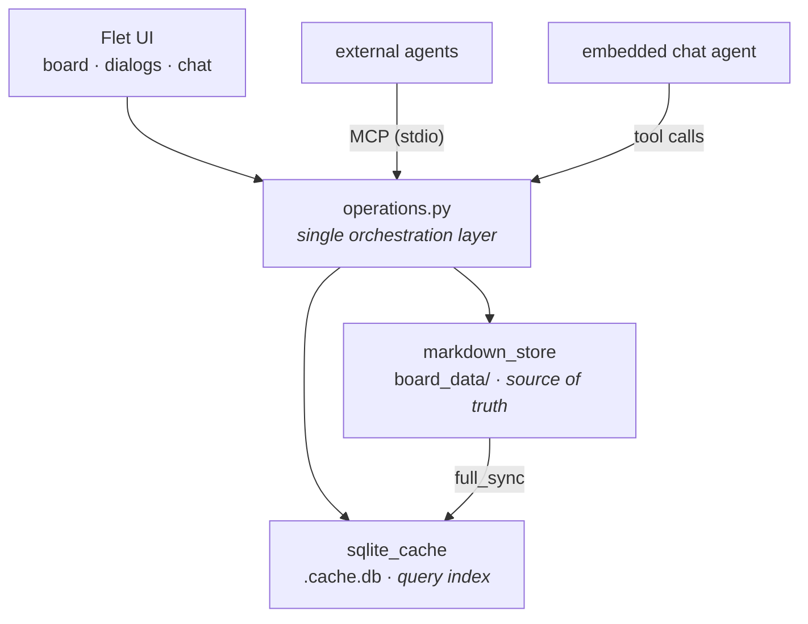

# Kanbai — V1

> **Kanbai** is an agent-compatible, local-first Kanban board. It pairs a Flet
> UI with an MCP server and an embedded AI chat agent, backed by git-trackable
> Markdown files.

This document captures everything built through **V1** — the major features and
a discussion of each (design, behavior, and key implementation points).

---

## Table of contents

1. [What Kanbai is](#what-kanbai-is)
2. [Architecture overview](#architecture-overview)
3. [Major features](#major-features)
4. [Feature discussions](#feature-discussions)
   - [Markdown + SQLite hybrid storage](#1-markdown--sqlite-hybrid-storage)
   - [Board operations layer](#2-board-operations-layer)
   - [MCP server](#3-mcp-server)
   - [Embedded AI chat agent](#4-embedded-ai-chat-agent)
   - [Chat modes — Ask / Plan / Agent](#5-chat-modes--ask--plan--agent)
   - [Model selector & context meter](#6-model-selector--context-meter)
   - [Flet UI](#7-flet-ui)
5. [Configuration](#configuration)
6. [Running Kanbai](#running-kanbai)
7. [Project structure](#project-structure)
8. [Known constraints & notes](#known-constraints--notes)

---

## What Kanbai is

Kanbai is a single-user (team-deployable) Kanban board designed so that **AI
agents are first-class citizens**. Cards live as Markdown files (the source of
truth, friendly to git), are indexed in SQLite for fast queries, and can be read
and modified by:

- the **human** through the Flet UI,
- the **embedded chat agent** (Azure OpenAI) inside the app, and
- **external agents** over the **MCP** (Model Context Protocol) server.

---

## Architecture overview



Everything funnels through `board/operations.py`, so the UI, the MCP server, and
the chat agent all share identical write semantics (Markdown + cache stay in
sync).

---

## Major features

| # | Feature | Summary |
|---|---------|---------|
| 1 | **Markdown + SQLite hybrid storage** | One `.md` file per card (git source of truth) + SQLite cache rebuilt on startup for fast queries. |
| 2 | **Board operations layer** | Single `operations.py` orchestrates create / get / list / update / move / archive across both stores. |
| 3 | **MCP server** | `fastmcp` server over stdio exposes board management tools so external agents can manage the board. |
| 4 | **Embedded AI chat agent** | In-app Azure OpenAI agent with function-calling that operates the board through the same operations layer. |
| 5 | **Chat modes (Ask / Plan / Agent)** | Three permission tiers enforced at the tool level — not just by prompt. |
| 6 | **Model selector & context meter** | Switch between `mini` / `nano` deployments; live context-window usage %; one-click context reset. |
| 7 | **Flet UI** | 4-column board, create/edit dialogs, floating AI chat with Markdown rendering. |

---

## Feature discussions

### 1. Markdown + SQLite hybrid storage

**Goal:** make the board git-native and human-readable while keeping queries
fast.

- **Source of truth:** one Markdown file per card under
  `board_data/{column}/{id}.md`. Card metadata lives in YAML frontmatter (`id`,
  `title`, `column`, `priority`, `tags`, `created_at`, `updated_at`, `archived`,
  `attachments`); the description is the Markdown body.
- **Query cache:** `.cache.db` (SQLite) is **gitignored** and rebuilt from the
  Markdown files on every startup via `sync.full_sync()`. It exists purely to
  make filtering by column/tags/text fast.
- **Why both:** Markdown gives clean diffs, easy manual edits, and a portable
  history in git. SQLite avoids re-parsing every file on each query.

**Key code:**
- `board/storage/markdown_store.py` — `write_card`, `read_card`,
  `move_card_file`, `load_all_cards`.
- `board/storage/sqlite_cache.py` — `init_db`, `upsert_card`, `delete_card`,
  `query_cards`, `get_card_by_id`.
- `board/storage/sync.py` — `full_sync()` returns the number of cards loaded.

**Card frontmatter example:**
```markdown
---
id: 5cee47ca-2dbb-49ae-87c5-ef817779feb3
title: Deploy service
column: backlog
priority: high
tags: [infra, ops]
created_at: 2026-06-09T10:00:00
updated_at: 2026-06-09T10:00:00
archived: false
---
Description body in Markdown…
```

---

### 2. Board operations layer

**Goal:** one place that guarantees Markdown and the SQLite cache never drift.

`board/operations.py` is the orchestration layer every caller (UI, MCP, chat
agent) goes through:

- `create_card(title, column, description, tags, priority)`
- `get_card(card_id)`
- `list_cards(column, tags, archived, query)`
- `update_card(card_id, title, description, tags, priority)`
- `move_card(card_id, target_column)`
- `archive_card(card_id)` — soft delete (sets `archived=True`, keeps git history)

Each write touches the Markdown file **and** upserts the cache, so all three
front-ends share identical behavior.

---

### 3. MCP server

**Goal:** let external agents (Copilot, Claude, etc.) operate the board.

`mcp_server/server.py` uses **fastmcp** over **stdio** transport
(`run_mcp_server()` → `mcp.run(transport="stdio")`). It exposes board management
tools for reading and modifying cards.

**Run it:** `python main.py --mcp`.

---

### 4. Embedded AI chat agent

**Goal:** an in-app assistant that can answer questions about the board and act
on it.

`agent/chat.py` wraps **Azure OpenAI** with function calling. The public entry
point is:

```python
chat(messages, mode="ask", model="nano") -> (reply, updated_messages, meta)
```

- `messages` — user/assistant turns only (the system prompt is injected per
  call based on mode).
- `meta` — `{"total_tokens", "context_window", "percent"}` from the API
  `usage`, used to drive the context meter in the UI.
- The agent runs a **tool-call loop**: it calls tools via `_dispatch_tool()`
  (which routes to `operations.py`), feeds the results back, and repeats
  until the model returns a final text reply.

The agent exposes OpenAI tool definitions mirroring the board operations.

---

### 5. Chat modes — Ask / Plan / Agent

**Goal:** make the assistant controllable with real, enforced guardrails.

Three modes, each a different **permission tier** plus a tailored system prompt:

| Mode | Tools available | Intent |
|------|-----------------|--------|
| **Ask** *(default)* | read-only | answer questions about the board |
| **Plan** | read-only | probe with questions, synthesize a plan, then suggest switching to Agent |
| **Agent** | read **+ write** | take direct action on the board |

The board only auto-refreshes after a turn when in **Agent** mode (the only mode
that can change anything).

> **Note on "Agent":** Kanbai's agent cannot execute arbitrary code. It is a
> *scoped tool-calling assistant* — the sandbox is the fixed operations
> tool set. "Agent mode" means "the write tools are available," nothing more.

---

### 6. Model selector & context meter

**Goal:** quick control over cost/quality and visibility into context usage.

- **Model selector** — a `mini` / `nano` dropdown. The label maps to a real
  Azure deployment via `_resolve_deployment()`:
  `nano` → `AZURE_OPENAI_DEPLOYMENT_NANO`, `mini` →
  `AZURE_OPENAI_DEPLOYMENT_MINI`. **Both must be set** (they may point to the
  same deployment if you only have one). Default model is **nano**.
- **Context meter** — a two-line `ctx / N%` readout computed from
  `usage.total_tokens ÷ KANBAI_CONTEXT_WINDOW` (default 128 000). It is
  color-coded: grey → orange at 60% → red at 85%.
- **Reset context** — the ↻ button opens a confirmation dialog; confirming
  clears the conversation history and the meter returns to 0%.

---

### 7. Flet UI

**Goal:** a clean board with integrated AI chat.

Runs in **web browser mode** (`ft.AppView.WEB_BROWSER`, port 8765) because the
Windows desktop renderer silently crashes on complex layouts.

- **Header** — `🤖 KB` logo pill, **Kanbai** title with "AI-powered Kanban"
  subtitle, and a card count.
- **Board** (`ui/board_view.py`) — four columns (Backlog, In Progress, Review,
  Done). Cards are color-coded by priority (low=green, medium=amber, high=red).
  `refresh_column()` re-queries SQLite and redraws a single column.
- **Card dialogs** (`ui/card_dialog.py`) — create/edit modals with title,
  10-line description box, tags, priority, and column ("Move to") controls; the
  edit dialog also offers Archive.
- **Chat panel** (`ui/chat_panel.py`) — floating overlay with a blue header bar,
  a gray control band (mode pills · model dropdown · ctx% · reset), a message
  list, and the composer. AI replies render as **Markdown**; user messages are
  plain text. Teams-style animated typing dots appear while the agent works.
  Chat bubbles use a directional "tail" corner (sharp corner toward the sender).

---

## Configuration

Environment variables (see `.env.example`; `.env` is gitignored):

| Variable | Required | Purpose |
|----------|----------|---------|
| `AZURE_OPENAI_ENDPOINT` | yes | Azure OpenAI resource endpoint |
| `AZURE_OPENAI_API_KEY` | yes | API key |
| `AZURE_OPENAI_DEPLOYMENT_MINI` | yes | Deployment behind the `mini` selector |
| `AZURE_OPENAI_DEPLOYMENT_NANO` | yes | Deployment behind the `nano` selector |
| `KANBAI_CONTEXT_WINDOW` | no | Token window for the ctx% meter (default 128000) |

> Both deployment vars are required. If you only have one deployment, set
> `MINI` and `NANO` to the same value.

---

## Running Kanbai

```powershell
# Install deps (uv)
uv sync

# Launch the app (web UI on http://127.0.0.1:8765)
uv run python main.py

# Run as an MCP server for external agents (stdio)
uv run python main.py --mcp
```

---

## Project structure

```
kanbai/
├── main.py                      # Entry point + CLI (--mcp)
├── pyproject.toml               # name = "kanbai", script: kanbai = "main:main"
├── .env.example
├── .gitignore                   # ignores .env, .cache.db
├── agent/
│   └── chat.py                  # Azure OpenAI agent, modes, model routing, ctx meta
├── board/
│   ├── models.py                # Card dataclass, COLUMNS, COLUMN_LABELS
│   ├── operations.py            # create/get/list/update/move/archive
│   └── storage/
│       ├── markdown_store.py    # .md read/write/move
│       ├── sqlite_cache.py      # query cache
│       └── sync.py              # full_sync() on startup
├── mcp_server/
│   └── server.py                # fastmcp stdio server
├── ui/
│   ├── board_view.py            # 4-column board + refresh
│   ├── card_dialog.py           # create/edit dialogs
│   └── chat_panel.py            # floating AI chat (modes/model/ctx/reset)
└── board_data/                  # git-tracked card files
    ├── backlog/  in_progress/  review/  done/  assets/
```

---

## Known constraints & notes

- **Desktop renderer:** the app uses web-browser mode on Windows because the
  native desktop window can crash silently with complex layouts.
- **Flet 0.85 API:** module helpers like `ft.padding.*`, `ft.margin.*`,
  `ft.border.*`, `ft.border_radius.*` do **not** exist; use the dataclass
  constructors (`ft.Padding`, `ft.Margin`, `ft.Border`, `ft.BorderRadius`).
  `ft.Dropdown` uses `on_select` (not `on_change`).
- **Env loading:** `load_dotenv()` runs in `main.py`. Standalone scripts that
  import `agent.chat` directly must load the env themselves.
