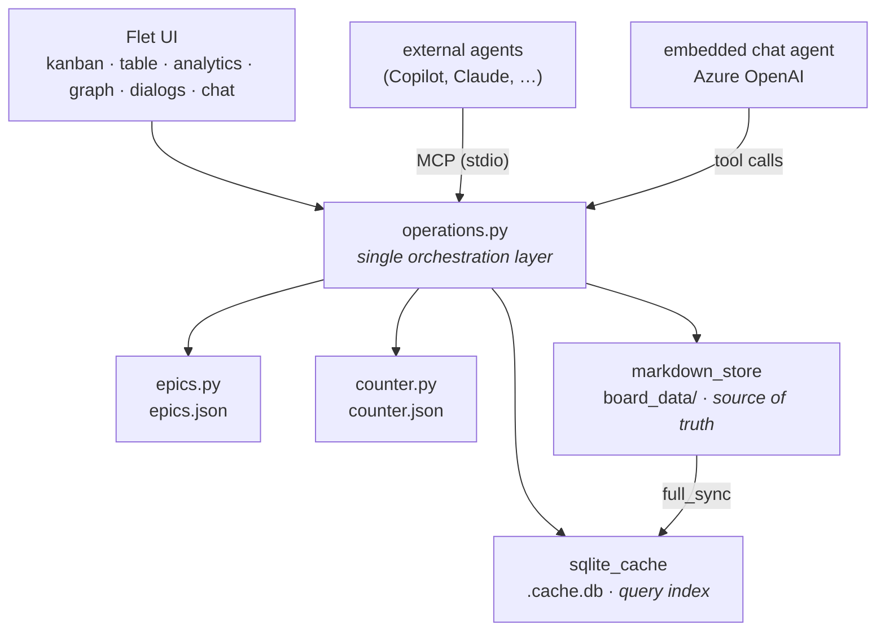

# Kanbai — V2

> **Kanbai** is an agent-compatible, local-first Kanban board. It pairs a Flet
> UI with an MCP server and an embedded AI chat agent, backed by git-trackable
> Markdown files.

This document is the V2 overview of **everything Kanbai does today**. It
supersedes [v1.md](v1.md) and folds in the work added since: epics, card
numbers, typed relationships, permanent deletion + Yolo mode, analytics, the
graph view, the table view, comments/assignees, and an expanded MCP surface.

The MCP server has its own deep-dive companion doc:

- **MCP** — capabilities and wiring external agents: [mcp.md](mcp.md)

---

## Table of contents

1. [What Kanbai is](#what-kanbai-is)
2. [Architecture overview](#architecture-overview)
3. [Feature map](#feature-map)
4. [The card model](#the-card-model)
5. [Board operations](#board-operations)
6. [Epics](#epics)
7. [Relationships (typed links)](#relationships-typed-links)
8. [Storage: Markdown + SQLite](#storage-markdown--sqlite)
9. [The UI: four views + dialogs](#the-ui-four-views--dialogs)
10. [Analytics](#analytics)
11. [Embedded AI chat agent](#embedded-ai-chat-agent)
12. [Chat modes — Ask / Plan / Agent / Yolo](#chat-modes--ask--plan--agent--yolo)
13. [MCP server](#mcp-server)
14. [Settings & timezone handling](#settings--timezone-handling)
15. [Configuration](#configuration)
16. [Running Kanbai](#running-kanbai)
17. [Project structure](#project-structure)
18. [What changed since V1](#what-changed-since-v1)
19. [Known constraints & notes](#known-constraints--notes)

---

## What Kanbai is

Kanbai is a single-user (team-deployable) Kanban board designed so that **AI
agents are first-class citizens**. Cards live as Markdown files (the source of
truth, friendly to git), are indexed in SQLite for fast queries, and can be read
and modified by:

- the **human** through the Flet UI,
- the **embedded chat agent** (Azure OpenAI) inside the app, and
- **external agents** over the **MCP** (Model Context Protocol) server.

The guiding principle: **one orchestration layer, three front-ends.** Whether a
change comes from a human click, the in-app agent, or an external agent over
MCP, it travels through the same code path so the Markdown files and the SQLite
cache never drift.

---

## Architecture overview



Everything funnels through `board/operations.py`, so all three callers share
identical write semantics. Epics and the card-number counter are small JSON
side-stores that operations coordinates with.

---

## Feature map

| Area | Feature | Summary |
|------|---------|---------|
| **Board** | Four columns | Backlog → In Progress → Review → Done. |
| **Board** | Card numbers | Auto-incrementing `#N` task numbers (`counter.json`) for human/agent reference. |
| **Board** | Priorities | low / medium / high, color-coded. |
| **Board** | Tags | Free-form labels, used for filtering and analytics. |
| **Board** | Comments | Timestamped comment thread per card. |
| **Board** | Assignees | `assigned_to` list, deduped case-insensitively; avatars on tiles. |
| **Board** | Attachments | File assets referenced from a card. |
| **Board** | Drag-reorder | Position-tracked reordering within and across columns. |
| **Lifecycle** | Archive / unarchive | Soft delete that keeps git history. |
| **Lifecycle** | Permanent delete | Irreversible — only allowed on already-archived cards. |
| **Grouping** | Epics | Named groupings with archive/unarchive + card snapshotting. |
| **Grouping** | Typed links | `blocks`/`blocked_by`, `parent`/`child`, `duplicate`, `relates_to` with auto-inverse. |
| **Views** | Kanban | The drag-drop board, epic + priority filters. |
| **Views** | Table | Tabular/sortable view of cards. |
| **Views** | Analytics | Counts, completion %, avg age, top tags, CFD, activity heatmap. |
| **Views** | Graph | Visual relationship/dependency graph of linked cards. |
| **AI** | Embedded chat agent | Azure OpenAI function-calling agent operating the board. |
| **AI** | Four chat modes | Ask / Plan / Agent / Yolo — enforced at the tool level. |
| **AI** | Model selector + ctx meter | `mini` / `nano` deployments; live context-window usage. |
| **AI** | Timezone-aware queries | Agent converts UTC timestamps to local for date questions. |
| **Integration** | MCP server | `fastmcp` over stdio — access-tiered (`read`/`write`/`yolo`). |
| **Config** | Settings | App settings (local vs UTC time display) in `settings.json`. |

---

## The card model

`board/models.py` defines `Card` as a dataclass. Key fields:

| Field | Type | Notes |
|-------|------|-------|
| `id` | `str` (uuid) | Stable identity, used in filenames. |
| `number` | `int` | Auto-increment task number (`#N`), human/agent friendly. |
| `title` | `str` | |
| `column` | `str` | `backlog` / `in_progress` / `review` / `done`. |
| `priority` | `str` | `low` / `medium` / `high`. |
| `description` | `str` | Markdown body. |
| `tags` | `list[str]` | |
| `epic` | `str \| None` | Epic name, or `None` for Unassigned. |
| `assigned_to` | `list[str]` | Deduped case-insensitively. |
| `comments` | `list[dict]` | `{id, text, created_at}`. |
| `attachments` | `list` | File assets. |
| `links` | `list[dict]` | `{type, number}` typed relationships. |
| `position` | `float` | Drag-reorder ordering within a column. |
| `created_at` / `updated_at` | `str` | UTC ISO-8601. |
| `archived` | `bool` | Soft-delete flag. |

---

## Board operations

`board/operations.py` is the single orchestration layer. Every caller (UI, MCP,
chat agent) goes through it, and every write touches **both** the Markdown file
and the SQLite cache.

- `create_card(title, column, description, tags, priority, epic, assigned_to)`
- `get_card(card_id)` / `list_cards(column, tags, archived, query, epic)`
- `update_card(...)` — only provided fields change (`_UNSET` sentinel
  distinguishes "leave unchanged" from "set to None", e.g. clearing an epic)
- `move_card(card_id, target_column)`
- `reorder_cards(target_column, ordered_ids)` — renumbers `position`
- `add_comment` / `delete_comment`
- `archive_card` / `unarchive_card`
- `delete_card` — **permanent**, only succeeds if the card is already archived
- Epic ops: `archive_epic_op` / `unarchive_epic_op`
- Link ops: `link_cards` / `unlink_cards`

---

## Epics

`board/epics.py` maintains `board_data/epics.json` — a small map of epic name →
`{archived, archived_card_ids}`.

- **Create** an epic as a first-class object (the agent has a dedicated
  `create_epic` tool so "create an epic" never accidentally creates a card).
- **Assign** cards to an epic (or `Unassigned`).
- **Archive** an epic: it snapshots the IDs of the cards archived alongside it,
  so unarchiving can restore exactly that set.
- **Invariant:** an archived epic must contain only archived cards. Assigning an
  *active* card to an archived epic raises `EpicArchivedError`.

---

## Relationships (typed links)

Cards link to each other by **task number** with a typed relationship.
`LINK_INVERSES` in `operations.py` defines the pairs:

| Link | Inverse |
|------|---------|
| `blocks` | `blocked_by` |
| `parent` | `child` |
| `duplicate` | `duplicate` (self) |
| `relates_to` | `relates_to` (self) |

Creating link A→B automatically creates the inverse B→A; unlinking removes both.
The [graph view](#the-ui-four-views--dialogs) renders these as a dependency
graph, and the priority filter keeps blockers visible even when they wouldn't
otherwise match.

---

## Storage: Markdown + SQLite

Unchanged in spirit from V1, now carrying the richer card model.

- **Source of truth:** one Markdown file per card under
  `board_data/{column}/{id}.md`. All metadata lives in YAML frontmatter; the
  description is the Markdown body.
- **Query cache:** `.cache.db` (SQLite, **gitignored**) is rebuilt from the
  Markdown files on every startup via `sync.full_sync()`. It powers fast
  filtering by column/tags/text/epic and the analytics aggregations.
- **Side-stores (JSON, git-tracked):** `epics.json`, `counter.json`,
  `settings.json`.

**Key code:** `board/storage/markdown_store.py`, `board/storage/sqlite_cache.py`,
`board/storage/sync.py`.

---

## The UI: four views + dialogs

Runs in **web browser mode** (`ft.AppView.WEB_BROWSER`, port 8765) because the
Windows desktop renderer can crash on complex layouts. Dark theme.

A left **navigation rail** switches between four views inside a single content
container; the header carries the logo, settings button, and card count.

1. **Kanban** (`ui/kanban_page.py`) — four-column drag-drop board with epic and
   priority filters. Cards color-coded by priority; archived cards in a faded
   section.
2. **Table** (`ui/table_page.py`) — tabular view of all cards.
3. **Analytics** (`ui/analytics_page.py`) — charts and board-health metrics (see
   below).
4. **Graph** (`ui/graph_page.py`) — visual relationship/dependency graph of
   linked cards, filterable by epic.

**Dialogs & panels:**
- **Card dialog** (`ui/card_dialog.py`) — create/edit with title, description,
  tags, priority, epic, assignees, comments, relationships, and column controls;
  edit offers Archive.
- **Chat panel** (`ui/chat_panel.py`) — floating AI chat (modes · model · ctx% ·
  reset), Markdown-rendered replies.
- **Settings dialog** (`ui/settings_dialog.py`) — app settings.

---

## Analytics

`get_board_summary(epic=None)` (and the SQLite aggregation helpers behind it)
produce:

- card **counts by column** and **by priority**
- **total**, **done**, and **completion %**
- **average age** of in-flight cards (days)
- **top tags** (top 10)
- **cumulative flow** data for the last 90 days (CFD)
- a **done-card activity heatmap** for the current year

The same summary is exposed to both the in-app agent and external agents (as the
`get_board_summary` tool), so "how healthy is this board / epic?" can be answered
conversationally.

---

## Embedded AI chat agent

`agent/chat.py` wraps **Azure OpenAI** with function calling. Entry point:

```python
chat(messages, mode="ask", model="nano") -> (reply, updated_messages, meta)
```

- The agent runs a **tool-call loop**: calls tools, feeds results back, repeats
  until it returns a final text reply.
- `meta` carries `{total_tokens, context_window, percent}` for the context meter.
- It resolves card references by number via `get_card_by_number`, and converts
  UTC timestamps to local time with `convert_timestamps_to_local` for any
  date-relative question (driven by the `use_local_tz` setting + a per-call
  timezone context string).

---

## Chat modes — Ask / Plan / Agent / Yolo

Four modes, each a different **permission tier** plus a tailored system prompt.
**Enforcement is at the tool level, not just the prompt** — `_tools_for_mode()`
physically removes tools the mode shouldn't have, so a jailbroken prompt still
can't reach them.

| Mode | Tools | Intent |
|------|-------|--------|
| **Ask** *(default)* | read-only | answer questions about the board |
| **Plan** | read-only | clarify + synthesize a plan, then suggest Agent |
| **Agent** | read **+ write** (no delete) | take direct action on the board |
| **Yolo** | read + write **+ permanent delete** | full power, irreversible deletes |

- **Read tools** (all modes): `list_cards`, `get_card`, `get_card_by_number`,
  `list_epics`, `convert_timestamps_to_local`, `get_board_summary`.
- **Write tools** (Agent + Yolo): create/update/move/archive/unarchive card,
  set/create/archive/unarchive epic, link/unlink.
- **Yolo-only:** `delete_card`.

Agent mode explicitly refuses permanent deletion and archives instead, telling
the user to switch to Yolo. The board auto-refreshes after a turn only in modes
that can change something.

> **"Agent" ≠ arbitrary code.** Kanbai's agent is a *scoped tool-calling
> assistant* — the sandbox is the fixed operations tool set.

---

## MCP server

`mcp_server/server.py` uses **fastmcp** over **stdio**. See **[mcp.md](mcp.md)**
for the full tool list, how to wire external agents, the access-tier model, and
how authentication works. Headlines:

- **Access tiers** via `KANBAI_MCP_ACCESS=read|write|yolo` (default `write`) —
  mirrors the chat agent's Ask/Agent/Yolo model; tools above the tier aren't
  registered. `write` can't permanently delete — that needs `yolo`.
- **Auth = local stdio launch trust** scoped by the access tier; no network
  surface, no login.
- Run with `python main.py --mcp`.

---

## Settings & timezone handling

`board/settings.py` stores app settings in `board_data/settings.json` (cached in
memory). Today the main setting is:

- `use_local_tz` (default `True`) — display stored UTC timestamps in the local
  timezone (analytics + kanban dates) vs raw UTC.

All timestamps are **stored in UTC**; display and agent date-reasoning convert to
local on demand.

---

## Configuration

Environment variables (`.env` is gitignored):

| Variable | Required | Purpose |
|----------|----------|---------|
| `AZURE_OPENAI_ENDPOINT` | yes | Azure OpenAI resource endpoint |
| `AZURE_OPENAI_API_KEY` | yes | API key |
| `AZURE_OPENAI_DEPLOYMENT_MINI` | yes | Deployment behind the `mini` selector |
| `AZURE_OPENAI_DEPLOYMENT_NANO` | yes | Deployment behind the `nano` selector |
| `KANBAI_CONTEXT_WINDOW` | no | Token window for the ctx% meter (default 128000) |
| `KANBAI_MCP_ACCESS` | no | MCP access tier: `read` / `write` / `yolo` (default `write`) |

> Both deployment vars are required. If you only have one deployment, point
> `MINI` and `NANO` at the same value.

---

## Running Kanbai

```powershell
# Install deps (uv)
uv sync

# Launch the app (web UI on http://127.0.0.1:8765)
uv run python main.py

# Run as an MCP server for external agents (stdio)
uv run python main.py --mcp
```

---

## Project structure

```
kanbai/
├── main.py                      # Entry point + CLI (--mcp)
├── paths.py                     # Repo-anchored data paths (cwd-independent)
├── pyproject.toml
├── agent/
│   └── chat.py                  # Azure OpenAI agent, modes, model routing, ctx meta
├── board/
│   ├── models.py                # Card dataclass, COLUMNS, COLUMN_LABELS
│   ├── operations.py            # create/get/list/update/move/reorder/archive/delete/link
│   ├── epics.py                 # epics.json CRUD + archive snapshotting
│   ├── counter.py               # auto-increment task numbers (counter.json)
│   ├── settings.py              # settings.json (use_local_tz, …)
│   └── storage/
│       ├── markdown_store.py    # .md read/write/move
│       ├── sqlite_cache.py      # query cache + analytics aggregations
│       └── sync.py              # full_sync() on startup
├── mcp_server/
│   └── server.py                # fastmcp stdio server (access-tiered)
├── ui/
│   ├── kanban_page.py           # drag-drop board + filters
│   ├── table_page.py            # tabular view
│   ├── analytics_page.py        # charts / board health
│   ├── graph_page.py            # relationship graph
│   ├── board_view.py            # column + card tile rendering
│   ├── card_dialog.py           # create/edit dialogs
│   ├── chat_panel.py            # floating AI chat
│   ├── settings_dialog.py       # settings UI
│   └── theme.py                 # shared styling
└── board_data/                  # git-tracked card files + JSON side-stores
    ├── counter.json  epics.json  settings.json
    └── backlog/  in_progress/  review/  done/  assets/
```

---

## What changed since V1

| Added in V2 | Detail |
|-------------|--------|
| **Card numbers** | `counter.py` / `counter.json`; `#N` references everywhere. |
| **Epics** | First-class groupings with archive snapshotting. |
| **Typed links** | Relationship graph with auto-inverse. |
| **Permanent delete** | `delete_card` (archived-only) + **Yolo** chat mode. |
| **Analytics** | `get_board_summary`, CFD, heatmap, top tags, avg age. |
| **Graph view** | Visual dependency/relationship graph. |
| **Table view** | Tabular browsing. |
| **Comments & assignees** | Per-card threads + assignment list. |
| **Drag-reorder** | Position tracking (`reorder_cards`). |
| **Settings + timezone** | `settings.json`, local-vs-UTC display, agent TZ conversion. |
| **Expanded MCP** | `KANBAI_MCP_ACCESS` tiers (epics, links, analytics, lifecycle). |
| **Vault removed** | Encrypted secrets vault removed; use OS keychain or a dedicated secrets manager instead. |

---

## Known constraints & notes

- **Desktop renderer:** web-browser mode on Windows because the native window
  can crash silently with complex layouts.
- **Flet 0.85 API:** use dataclass constructors (`ft.Padding`, `ft.Margin`,
  `ft.Border`, `ft.BorderRadius`) — the module helpers don't exist.
  `ft.Dropdown` uses `on_select`.
- **Env loading:** `load_dotenv()` runs in `main.py`. Scripts importing
  `agent.chat` directly must load env themselves.
- **Cache is disposable:** `.cache.db` is rebuilt from Markdown on startup;
  Markdown is the only source of truth.
