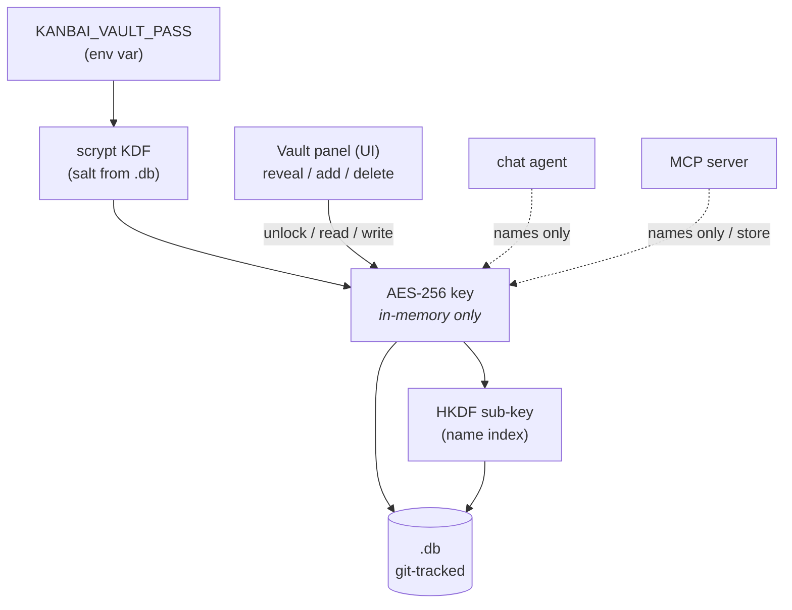
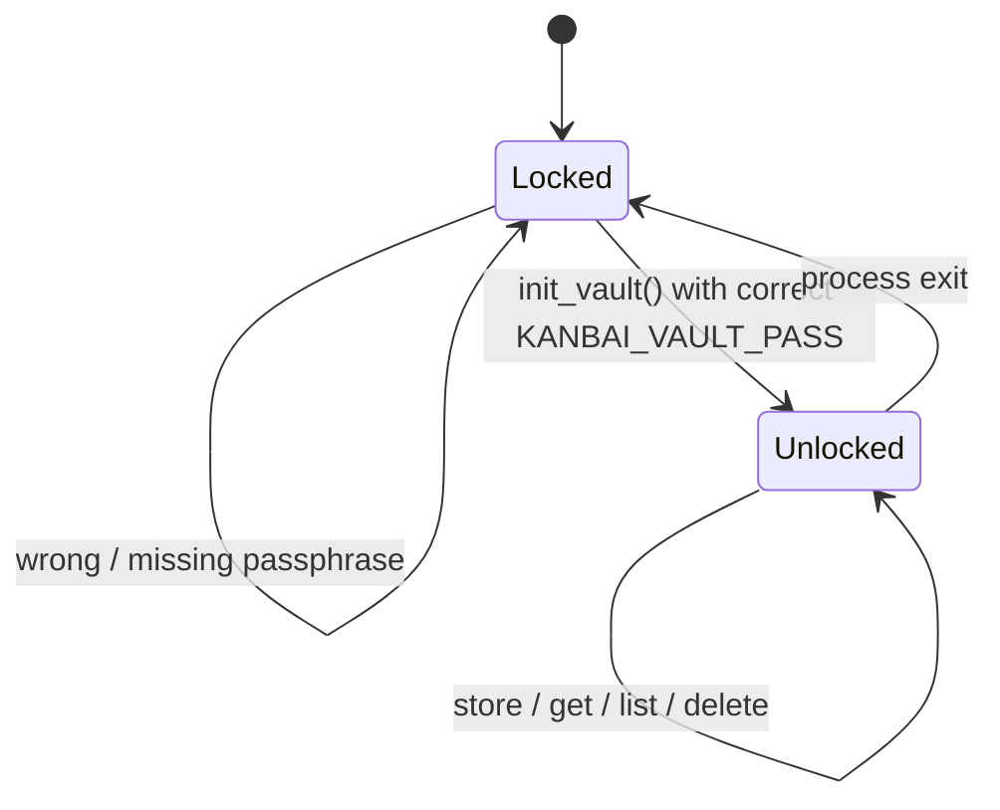

# Kanbai — The Vault

> A focused look at Kanbai's encrypted secrets vault: **what it is, how it's
> built, what it protects against, what it does *not* protect against, and which
> workflows are encouraged vs. forbidden.**

The vault lives in `vault/vault.py` and stores its data in `.db`. This
document is for anyone deciding *whether and how* to use it.

---

## TL;DR

- The vault is a **personal convenience scratchpad** for named secrets — **not a
  secrets manager**.
- It uses **AES-256-GCM** with a key derived from a passphrase via **scrypt**;
  the key lives **only in process memory**.
- **Both names and values are encrypted.** `.db` is git-tracked but a
  snooper sees only HMAC indexes and ciphertext.
- **No code path — human UI aside — can read a secret value programmatically.**
  Neither the chat agent nor MCP exposes a "get value" operation. This is
  deliberate.
- **Use it for local development only.** Do **not** wire applications, CI/CD, or
  production workloads to it. For those, use Azure Key Vault / AWS Secrets
  Manager / HashiCorp Vault.

---

## Table of contents

1. [What the vault is (and isn't)](#what-the-vault-is-and-isnt)
2. [Architecture](#architecture)
3. [Cryptographic design](#cryptographic-design)
4. [Lock / unlock lifecycle](#lock--unlock-lifecycle)
5. [Rekey & audit log](#rekey--audit-log)
6. [The agent boundary](#the-agent-boundary)
7. [Threat model: what it protects against](#threat-model-what-it-protects-against)
8. [Risks: what it does *not* protect against](#risks-what-it-does-not-protect-against)
9. [Encouraged use cases](#encouraged-use-cases)
10. [Workflows to avoid](#workflows-to-avoid)
11. [Operational checklist](#operational-checklist)

---

## What the vault is (and isn't)

**Is:** a place to jot down the credentials you keep referencing while working a
board — an API key you paste into a terminal, a connection string you copy into
a `.env`, a token you want associated with a card — without leaving them in
plaintext in the repo. Cards can *reference a secret by name* (`card.secrets`)
so you know "this task needs `PROD_DB_PASSWORD`" without the value ever touching
the card.

**Isn't:** a runtime secrets provider. It has no rotation policy engine, no
access-control lists, no per-secret audit of reads, no network API, no
short-lived leases. It is intentionally minimal.

> ⚠️ **Treat it like an encrypted sticky note, not a key management system.**

---

## Architecture

`.db` has three tables:

| Table | Purpose |
|-------|---------|
| `meta` | `salt` (plaintext — not secret), `verify` (encrypted sentinel). |
| `secrets` | `name_hash` (PK, keyed HMAC), `name_enc` (AES-GCM blob), `value_enc` (AES-GCM blob). |
| `rekey_log` | Audit trail of passphrase rotations (`rekeyed_at`, `secret_count`). |

There is **no plaintext name column** — older plaintext-name databases are
auto-migrated to the encrypted schema on first unlock
(`_migrate_plaintext_names`).

---

## Cryptographic design

| Concern | Choice | Why |
|---------|--------|-----|
| Cipher | **AES-256-GCM** | Authenticated encryption — detects tampering. |
| KDF | **scrypt** (`n=2¹⁴, r=8, p=1`, 32-byte key) | Memory-hard; resists brute force on the passphrase. |
| Salt | 32 random bytes in `meta.salt` | Plaintext is fine — salt isn't secret; defeats rainbow tables. |
| Nonce | 12 random bytes prepended to each blob | Fresh per encryption; never reused. |
| Name index | **HMAC-SHA256** under an **HKDF-derived sub-key** | Deterministic lookups without exposing names; sub-key never reuses the AES key. |
| Key verification | Encrypted **sentinel** (`meta.verify`) | A wrong passphrase fails to decrypt the sentinel → vault stays locked instead of deriving a garbage key. |

**Why names are HMAC'd *and* encrypted:** the HMAC `name_hash` is a deterministic
primary key so `store`/`get`/`delete` can find a row without scanning. But an
HMAC isn't reversible, so the real name is *also* stored as an AES-GCM blob
(`name_enc`) for listing. Without the vault key you can compute neither — the
committed DB leaks nothing.

---

## Lock / unlock lifecycle

- **Unlock:** `init_vault()` reads `KANBAI_VAULT_PASS`, derives the key, and
  checks it against the sentinel. Returns `True` only if the passphrase is
  correct. The key is stored in the module-level `_vault_key`.
- **Locked state:** with no key in memory, `store_secret`, `get_secret`,
  `list_secret_names`, and `delete_secret` all raise `VaultLockedException`.
- **No persistence of the key:** the key exists only for the life of the
  process. Restart without the env var → vault is locked → DB is opaque.

---

## Rekey & audit log

`rekey_vault(old_passphrase, new_passphrase)`:

1. Derives the old key, decrypts every secret (name + value).
2. Generates a **brand-new salt** and key (fully independent of the old one).
3. Re-encrypts everything (the `name_hash` changes, so rows are rebuilt).
4. Writes a fresh sentinel and an entry to `rekey_log`.

Run interactively with `python main.py --rekey` (uses `getpass`, confirms the
new passphrase, prints the last rekey event). **Afterwards, update
`KANBAI_VAULT_PASS`** to the new passphrase or the next start will be locked.

The `rekey_log` records *that* a rotation happened and how many secrets were
involved — it does **not** log individual secret reads (there is no per-read
audit).

---

## The agent boundary

This is the single most important security property of the vault.

| Caller | Can list names? | Can store? | Can read a value? |
|--------|-----------------|------------|-------------------|
| **Human (UI)** | ✅ (when unlocked) | ✅ | ✅ (reveal button) |
| **Chat agent** | ✅ `list_secret_names` | ❌ | **❌ no tool exists** |
| **External agent (MCP)** | ✅ `vault_list_secrets` | ✅ `vault_store_secret` | **❌ no tool exists** |

There is deliberately **no `get_secret` / `vault_get_secret` tool**. An agent can
discover that `PROD_DB_PASSWORD` exists, but can never retrieve its value through
Kanbai. When the vault is locked, the MCP tool returns an empty list and the
chat tool returns a `vault_locked` notice. This keeps the vault from becoming a
backdoor secret source for automated callers.

> The only way a value leaves the vault is a human clicking **reveal** in the UI.

---

## Threat model: what it protects against

✅ **Plaintext-in-git leakage.** The whole point: `.db` can be committed
and pushed, and an attacker reading the repo sees only ciphertext and HMACs — no
names, no values.

✅ **Casual disk inspection.** Someone browsing the repo folder (or a stale clone
on a backup drive) without the passphrase learns nothing.

✅ **Agent exfiltration.** A compromised or jailbroken agent (in-app or external)
cannot read values — the capability simply isn't exposed.

✅ **Passphrase brute force (to a degree).** scrypt's memory-hardness makes
offline guessing expensive, proportional to passphrase strength.

✅ **Tampering.** AES-GCM authentication means a modified `.db` fails to
decrypt rather than silently returning corrupted data.

---

## Risks: what it does *not* protect against

❌ **A weak passphrase.** scrypt slows brute force; it doesn't save a 6-character
passphrase. The security ceiling is your passphrase entropy.

❌ **A compromised host while unlocked.** The AES key sits in process memory
while the app runs. Malware with the same user privileges, a memory dump, or a
debugger attached to the process can recover the key and values. **Local dev
only** assumes a trusted machine.

❌ **The passphrase itself.** `KANBAI_VAULT_PASS` is an environment variable. If
it leaks (shell history, a `.env` committed by accident, CI logs, a screen
share), the vault is fully exposed. It is shared **out-of-band** for teams — that
channel is your weakest link.

❌ **Loss of the passphrase.** There is **no recovery**. Lose it and the
encrypted values are gone forever (by design).

❌ **Human reveal misuse.** A value revealed in the UI is on screen / clipboard —
ordinary endpoint hygiene applies.

❌ **Production-grade controls.** No rotation policies, no per-secret ACLs, no
read auditing, no leasing, no HSM backing. It is not, and should not be used as,
a secrets manager.

---

## Encouraged use cases

✅ **Local development convenience.** Keep the handful of keys/tokens you
re-reference while working a board, encrypted, instead of in a scratch file.

✅ **Card ↔ secret association.** Note on a card that it depends on a named secret
(via `card.secrets`) without ever embedding the value.

✅ **Personal, single-user boards.** One person, one trusted machine, one
passphrase — the sweet spot.

✅ **Small team with an out-of-band shared passphrase**, *if* everyone
understands it's a convenience store and treats the machine as trusted.

✅ **Committing `.db` to git.** Encouraged and safe — that's what the
encryption is for. (`.env` and `.cache.db` stay gitignored.)

---

## Workflows to avoid

❌ **Don't wire applications/scripts/services to pull live secrets from it.**
There's no read API for automation on purpose — don't try to add one or
screen-scrape the UI.

❌ **Don't use it for production credentials or runtime config.** Use a real
secrets manager (Azure Key Vault, AWS Secrets Manager, HashiCorp Vault).

❌ **Don't use it in CI/CD.** No machine-to-machine read path; injecting the
passphrase into a pipeline defeats the model.

❌ **Don't reuse an important passphrase** as `KANBAI_VAULT_PASS`, and don't
commit a `.env` containing it.

❌ **Don't treat "it's encrypted" as "it's safe on an untrusted host."** While
unlocked, values are recoverable from process memory by a local attacker.

❌ **Don't rely on it as your only copy of a critical secret.** Lose the
passphrase and it's unrecoverable — keep an authoritative copy in a real manager.

---

## Operational checklist

- [ ] Use a strong, unique `KANBAI_VAULT_PASS`.
- [ ] Keep `.env` gitignored; never commit the passphrase.
- [ ] Share the passphrase out-of-band (not in chat/email/the repo).
- [ ] Keep an authoritative copy of anything critical in a real secrets manager.
- [ ] Run on a trusted machine; assume "unlocked" means "exposed to local
      attackers."
- [ ] Rotate with `--rekey` if you suspect exposure, then redistribute the new
      passphrase out-of-band.
- [ ] Remember: lost passphrase = unrecoverable data, by design.
